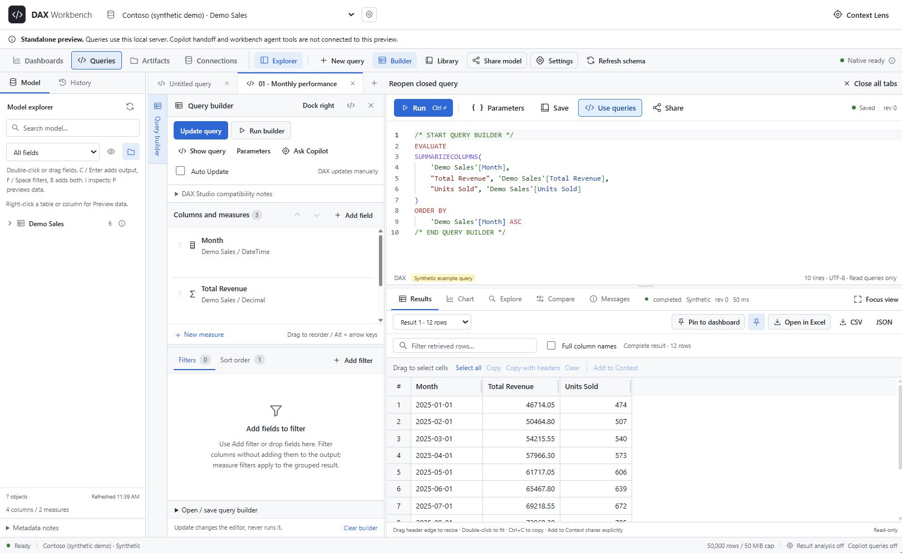
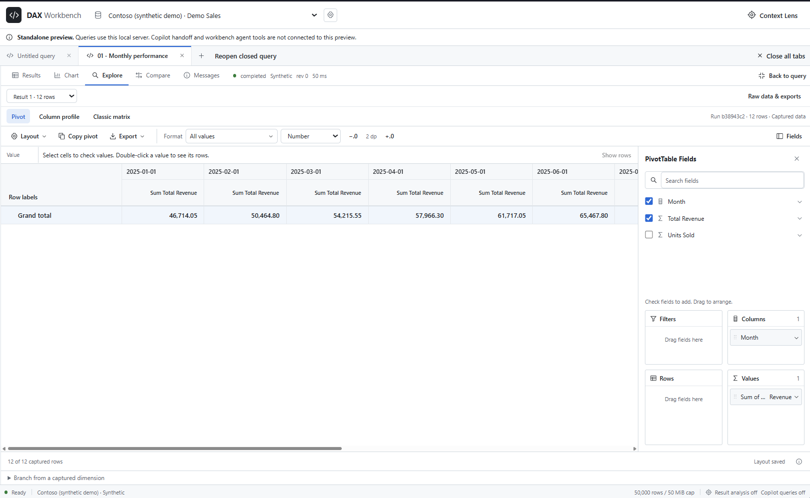
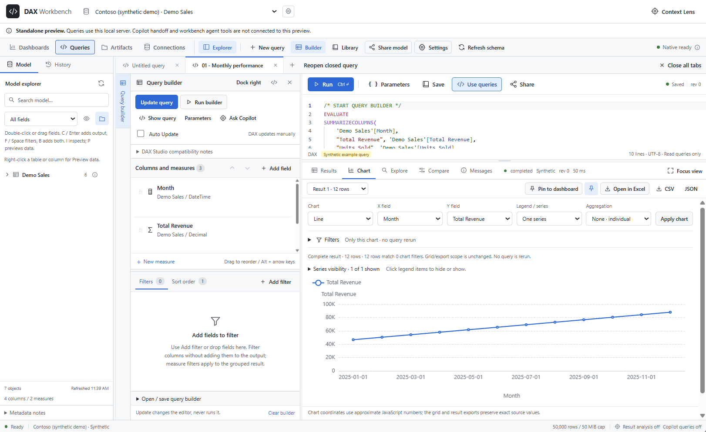
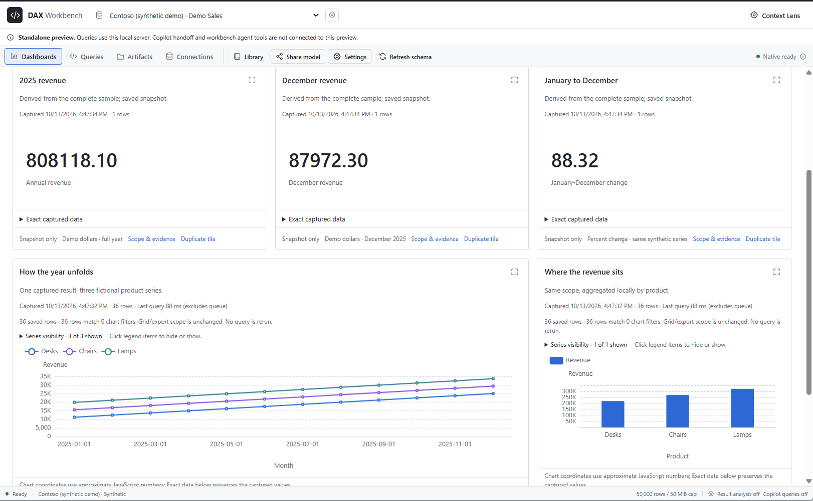
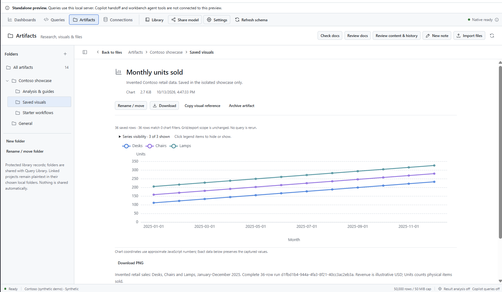
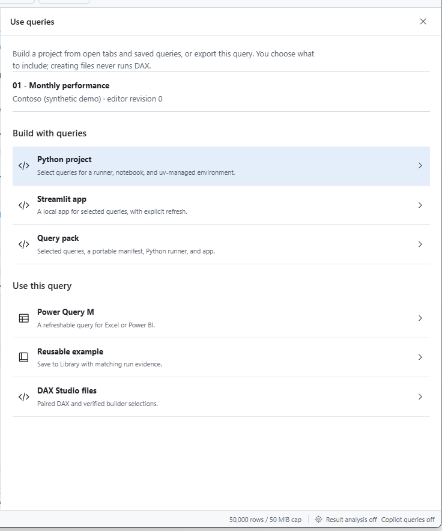
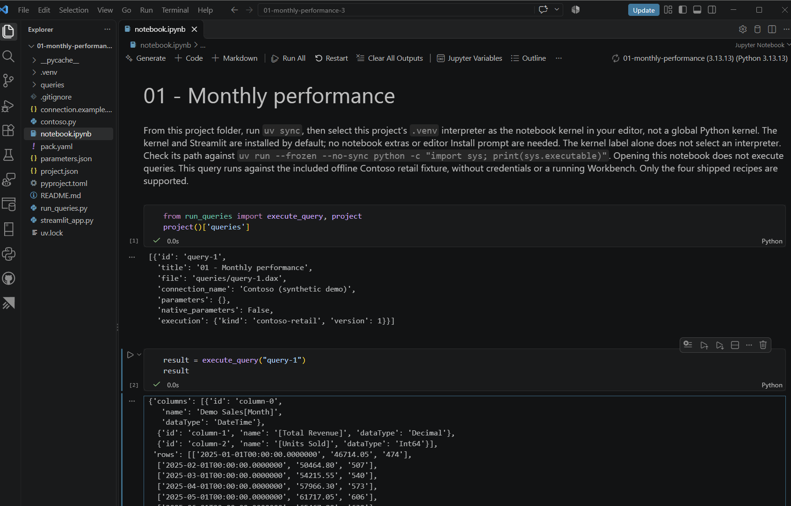
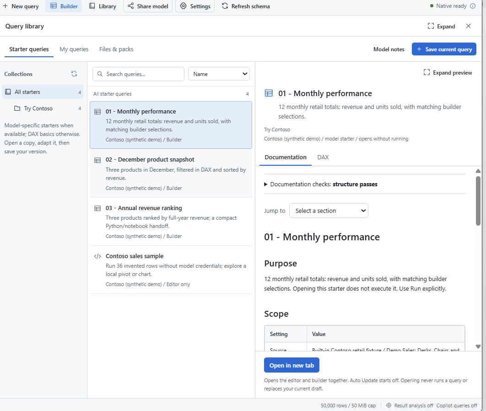
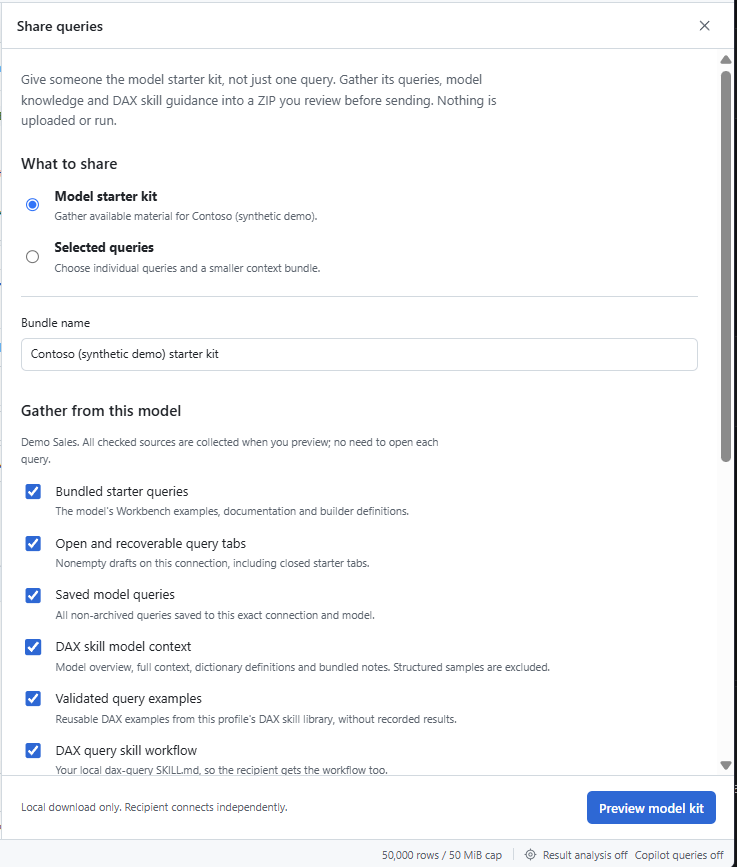

# DAX Workbench

**A Copilot-connected analysis workspace, not another DAX engine.**

Your semantic model still runs DAX. Workbench brings the rest together:
build a query with Copilot, explore its results, save the analysis, and turn
it into a notebook or app without starting over.

*Model fields, builder selections, inspectable DAX and exact results together.*

## How is it different from DAX Studio?

Inspired by [DAX Studio](https://daxstudio.org/), with a different emphasis:
**the workflow from a question to reusable analysis**, rather than deep engine diagnostics.

| Area | DAX Studio | DAX Workbench |
|---|---|---|
| Where you work | Standalone DAX querying and tuning tool. | Inside Copilot, beside the conversation. |
| Building queries | DAX editor and visual Query Builder. | Visual builder and editor that Copilot can populate or propose changes to, using model context. |
| Exploring results | Query results and diagnostic workflows. | Interactive pivots, charts and saved dashboard snapshots from captured results. |
| Reusing work | Query files and data exports. | Saved queries, research notes and visuals; handoffs to Python, notebooks, Streamlit and Power Query. |
| Deep diagnostics | Server Timings, query plans and VertiPaq model metrics. | Client timing only; no equivalent engine diagnostics in this pilot. |

Keep DAX Studio for tuning. Workbench can export DAX Studio files, so you can use both.
See DAX Studio's [Query Builder](https://daxstudio.org/docs/features/query-builder/),
[Server Timings](https://daxstudio.org/docs/features/traces/server-timings-trace/) and
[Model Metrics](https://daxstudio.org/docs/features/model-metrics/).

## Why a Copilot extension?

**Less copying between a chat and a query tool.** Copilot can work with the
active query, model schema and visual builder in the same workspace.
You inspect the DAX, explore the result and keep useful analysis beyond the chat.

Authoring, execution and sharing results are separate decisions. Agent query
and result-analysis access start **off**; you choose what to enable.

## Explore the result, not another query

**Pivot the data you already captured.** Drag fields into rows, columns and
values, change number formats, and inspect the rows behind a cell without
rerunning DAX.

**Switch from detail to trend.** Chart the same result to see monthly patterns
or compare products, while the grid retains the exact source values.

## Keep more than a query file

**Build a view worth coming back to.** Combine indicators, charts and tables
into saved dashboards. Opening one shows its saved snapshots; refreshing is
an explicit action.

**Save the useful finding.** Artifacts keeps charts and research notes with
source references, so the analysis is not buried in a chat or reduced to a PNG.

## Turn a query into something reusable

**Choose the next destination.** Preview selected queries as a Python project,
Streamlit app, Power Query M, query pack or DAX Studio files. Review the output
before creating anything; setup and execution are separate steps.

**Continue in a notebook.** Generated projects include the queries, runner,
notebook and setup instructions. The Contoso example runs offline; real-model
projects need their own connection configuration.

## Start from an example. Share what works.

**Make good queries easy to find again.** The Library keeps queries with their
documentation and builder selections. The included Contoso starters give you
something useful to open immediately.

**Give someone a starting point, not your working environment.** Review the
queries and notes selected for a model starter kit before exporting it locally.
Sharing is deliberate, and the recipient connects independently.

All screenshots use synthetic Contoso data. The isolated preview has no live
Copilot integration; the notebook shows an offline run. See
[image provenance](media/capture-manifest.json) for preview/release differences.

## Get the extension

**[Download the Windows x64 pilot](https://github.com/wes-stone/dax-workbench/releases/tag/v0.1.0-pilot.1), extract it,
run `Install.ps1 -DownloadMicrosoftPrerequisites`, then reload extensions in Copilot.** Setup
downloads two pinned Microsoft client packages directly from NuGet after you review
their terms. Internet is needed for setup; no compilation is needed
for that package. See [installation and requirements](INSTALL.md).

The repository and release are private; downloads require repository access.
You can also [build from source](INSTALL.md#build-from-source). Do not
point Copilot's repository-folder installer at this unbuilt source tree.

## Try it

Open **DAX Workbench**, click **Run Contoso sample**, then explore the results.
**Library > Try Contoso** has three more examples. No model credentials or
separate MSOLAP installation are needed for this demo. Its four fixed recipes
are a starting point, not a general DAX engine.

**Requirements:** Windows x64, Node.js 24+ and a canvas-capable GitHub Copilot
host with Copilot access. For Windows MSOLAP connections to real models, install
**Microsoft Analysis Services OLE DB Provider (MSOLAP), x64/amd64**
([Microsoft download](https://go.microsoft.com/fwlink/?linkid=829576)) and
**.NET Framework 4.8**; model access is still required. MSOLAP is not bundled.

**Windows pilot; unsigned.** Independent project, not an official
GitHub or Microsoft product. [Publication checklist](PUBLICATION-CHECKLIST.md).
